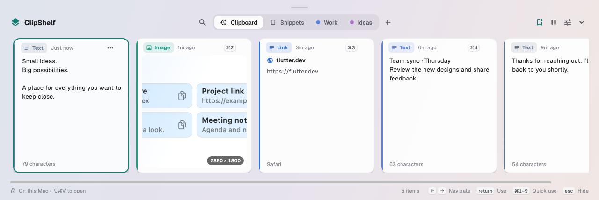
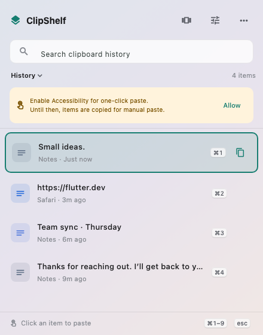
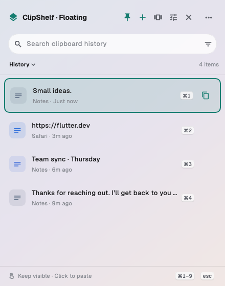

<div align="center">

# 📋 ClipShelf

**Everything you copy, one keystroke away.**

A fast, private clipboard manager that lives in your Mac's menu bar.

[](https://github.com/mrtarunsaraswat/clipshelf/releases/latest)

[](https://github.com/mrtarunsaraswat/clipshelf/actions/workflows/macos.yml)


[](LICENSE)



</div>

## ✨ Why ClipShelf

- **Never lose a copy.** Text, links, images, rich text, and files are saved automatically.
- **Paste in one click.** Pick a clip and it goes straight into the app you were using.
- **Built for the keyboard.** <kbd>⌥</kbd><kbd>⌘</kbd><kbd>V</kbd> to open, <kbd>⌘</kbd><kbd>1</kbd>–<kbd>9</kbd> to paste.
- **Keep what matters.** Save snippets and sort clips into colored pinboards.
- **Screenshots included.** Screenshots you take are copied and saved to your history.
- **Favorites on your desktop.** A widget puts your snippets one click away (macOS 14+).
- **Private by design.** Everything stays on your Mac. No account, no server, no tracking.

## 🖼️ A look inside

<table>
  <tr>
    <td align="center" width="50%"><br><b>Menu-bar panel</b><br>Search and paste without leaving your app</td>
    <td align="center" width="50%"><br><b>Floating panel</b><br>Pin it next to your work</td>
  </tr>
</table>

## 🚀 Install

1. **[Download the latest DMG](https://github.com/mrtarunsaraswat/clipshelf/releases/latest)**, open it, and drag **ClipShelf** into **Applications**.
2. Open ClipShelf. macOS will block the first launch. Click below for how to allow it.
3. Allow **Accessibility** access when asked, so ClipShelf can paste for you.

<details>
<summary><b>"ClipShelf can't be opened": how to allow it (one time only)</b></summary>

<br>

ClipShelf isn't notarized by Apple yet, so macOS asks you to confirm it once.

- **macOS 15 Sequoia or later:** open **System Settings → Privacy & Security**, scroll down, click **Open Anyway** next to ClipShelf, and confirm.
- **macOS 12–14:** Control-click ClipShelf in **Applications**, choose **Open**, then click **Open** again.

Want to verify the download? `shasum -a 256 -c ClipShelf-<version>.dmg.sha256`

</details>

<details>
<summary><b>Direct paste isn't working</b></summary>

<br>

Open **System Settings → Privacy & Security → Accessibility** and turn on **ClipShelf**. After an update, remove the old ClipShelf entry and allow it again. Without this access, ClipShelf still copies, and you paste with <kbd>⌘</kbd><kbd>V</kbd>.

</details>

## ⌨️ Shortcuts

| Shortcut | What it does |
| --- | --- |
| <kbd>⌥</kbd><kbd>⌘</kbd><kbd>V</kbd> | Open the shelf |
| <kbd>⌘</kbd><kbd>1</kbd> … <kbd>⌘</kbd><kbd>9</kbd> | Paste one of the first nine clips |
| <kbd>Return</kbd> | Paste the selected clip |
| <kbd>⌘</kbd><kbd>F</kbd> | Search |
| <kbd>Space</kbd> | Preview |
| <kbd>⌘</kbd><kbd>N</kbd> | New snippet |
| <kbd>⇧</kbd><kbd>⌘</kbd><kbd>N</kbd> | New pinboard |
| <kbd>Esc</kbd> | Hide |

ClipShelf has no Dock icon. Find it in the menu bar, and right-click the icon for Pause and Quit.

## ❓ FAQ

<details>
<summary><b>Where is my data stored?</b></summary>

<br>

Only on your Mac, in `~/Library/Application Support/ClipShelf/`. By default ClipShelf keeps your 200 most recent clips; in **Preferences → History** you can keep 100 to 1,000 items and have older ones removed automatically after a day, a week or a month. Snippets and pinned items are kept until you delete them.

</details>

<details>
<summary><b>Does it save my passwords?</b></summary>

<br>

ClipShelf skips copies that password managers mark as concealed. Some apps don't mark them, though, so pause capture from the menu bar before copying something sensitive.

</details>

<details>
<summary><b>How do I add the desktop widget?</b></summary>

<br>

On macOS 14 or later, turn on **Desktop Favorites widget** in ClipShelf's Preferences. Then right-click the desktop, choose **Edit Widgets…**, and add **ClipShelf Favorites**. Right-click the widget → **Edit Widget** to pick Snippets or a pinboard. Click a favorite to copy it. After updating ClipShelf, you may need to remove and re-add the widget.

</details>

<details>
<summary><b>Is there iCloud sync?</b></summary>

<br>

**Coming soon.** iCloud sync will keep your history, snippets and pinboards in step across your Apple devices. Until then, everything stays on this Mac. See [iCloud sync](docs/ICLOUD.md).

</details>

## 📚 Learn more

- [User guide](docs/USER_GUIDE.md): every feature in detail
- [Changelog](CHANGELOG.md)
- [Developing ClipShelf](docs/DEVELOPMENT.md): build from source, tests, and releasing
- [Architecture](docs/ARCHITECTURE.md)

<details>
<summary><b>Build from source</b></summary>

<br>

Requires Xcode and Flutter 3.50 or later.

```sh
flutter pub get
flutter run -d macos          # run in development
./scripts/build_macos.sh      # release build in build/macos/…/ClipShelf.app
```

</details>

## 📄 License

[MIT](LICENSE) © 2026 Tarun Sharma. Built with [Flutter](https://flutter.dev).

<p align="center">Made with ♥ by <a href="https://www.linkedin.com/in/mrtarunsaraswat/">Tarun</a></p>
