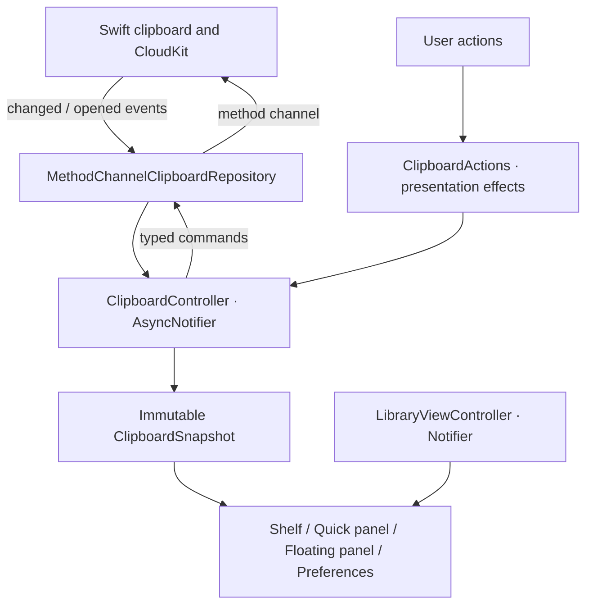

# ClipShelf architecture

ClipShelf uses Riverpod without code generation. Native Swift code continues to own clipboard capture, persistence, Accessibility checks, window behavior, and CloudKit. This refactor changes how Flutter receives, controls, and presents that state.

## Data flow



## Modules and responsibilities

- `lib/main.dart` starts `ProviderScope` and the app. It contains no state or platform logic.
- `lib/app/` contains the app widget and theme.
- `features/clipboard/domain/` contains immutable clipboard items, pinboards, sync status, snapshots, native-event types, and the repository contract. Incoming byte arrays and collections are copied into unmodifiable views.
- `features/clipboard/data/` contains the method-channel adapter. It owns the one native handler, parses incoming events, maps typed commands to native method names, and translates platform errors into `ClipboardFailure`.
- `features/clipboard/application/clipboard_controller.dart` owns asynchronous initialization, native-event subscriptions, refreshes, and clipboard/settings commands. `clipboardRepositoryProvider` is its replaceable dependency.
- `features/clipboard/application/library_view_controller.dart` owns the query, typed format/collection filters, and selection. Derived providers compute visible and selected items. Moving selection does not re-run filtering merely because the selection changed.
- `features/clipboard/application/panel_session.dart` tracks repeated native open events, even when the presentation mode stays the same. A quick-panel open resets the library query/collection through its controller. The screen listens only to apply focus and scroll effects.
- `features/clipboard/presentation/clipboard_actions.dart` coordinates dialogs and snackbars, then calls typed controller methods. Providers and repositories never receive a `BuildContext`.
- `features/clipboard/presentation/widgets/` contains separate shelf, menu-bar panel, card, row, collection-tab, preview, empty-state, and item-menu widgets.
- `features/settings/presentation/` watches permission and sync selectors directly. An open Preferences dialog receives updates from the same snapshot as the panel; no revision counter or manual dialog rebuild is required.
- `features/snippets/` and `features/pinboards/` contain creation drafts and forms. Text controllers and temporary pinboard color selection are local widget state, with normal widget disposal.

## Lifetime and asynchronous updates

One repository instance and one controller subscription live under the app's `ProviderScope`. The repository unregisters the method handler on disposal; the controller cancels its stream subscription. Late refresh results check `ref.mounted` before publishing state.

Initial reads retain the latest native update received while loading. Refreshes also track both request order and native-event revisions, preventing an older response from rolling back a newer permission or clipboard update. Initial failures are exposed as `AsyncError`; an explicit refresh or subsequent native event can recover. A refresh failure preserves existing history and attaches a warning. Failed commands surface through presentation error handling without deleting the current snapshot.

Async provider build retries are disabled because repeated native initialization should be intentional. Native panel-open events trigger fresh state reads. Native Swift still publishes permission changes independently of clipboard capture.

## Testing

`test/clipboard_controller_test.dart` replaces the repository using:

```dart
final container = ProviderContainer(
  overrides: [clipboardRepositoryProvider.overrideWithValue(fakeRepository)],
);
await container.read(clipboardControllerProvider.future);
```

These tests run without macOS, exercise async races and disposal, and verify filtering, selection, typed commands, errors, immutable data, and live permission/sync state. `test/support/fake_clipboard_repository.dart` provides the in-memory boundary.

`test/widget_test.dart` exercises the real method-channel adapter against a mocked platform endpoint, checking user-visible behavior and outgoing native command arguments. It includes permission updates while Preferences is open and repeated quick-panel open events. Both visual previews are checked against the existing images without accepting new golden files.

```sh
flutter analyze
flutter test
flutter test tool/preview_test.dart
flutter test --dart-define=QUICK_PREVIEW=true \
  --dart-define=ACCESSIBILITY_PREVIEW=true tool/preview_test.dart
```

The existing native checks and macOS build remain part of verification. Live iCloud still requires owner provisioning and two-Mac testing, as described in the README. This refactor does not activate iCloud or change the native fullscreen implementation.


## Floating mode and WidgetKit

The native `NSPanel` and Flutter engine are reused across shelf, quick, and floating modes. `PanelPresentation.floating` selects the compact list. Pin state arrives in the immutable snapshot, and pin/drag/open/share commands follow the existing Actions → Controller → Repository path. No parallel Flutter collection or clipboard listener is created.

`FloatingPanelState` stores only this device's frame and Keep visible setting. Native outside-click/app-switch handling dismisses transient modes; a pinned floating panel remains visible. Paste releases key focus before showing the pinned panel without taking focus. Explicit Close/Escape always hides it. Native move/resize notifications save geometry, clamped to available displays on reopening.

The WidgetKit extension is SwiftUI with AppIntent configuration and copy actions, built for macOS 14+. The host still supports macOS 12+. `WidgetLibraryExporter` projects the canonical archive into a bounded saved-text-only snapshot. Shared Foundation models/store are compiled into both targets. The host writes atomically and asks WidgetKit to reload only when content changes. Sharing preferences and copy feedback are local, separate from CloudKit.

A widget tap resolves the current favorite ID from the shared snapshot before writing the general pasteboard. It cannot copy a stale removed value from a timeline. A short feedback record supports a checkmark after copying; a later timeline clears it. Open links route through the existing window bridge using the `clipshelf` URL scheme. Link handling does not create a second clipboard service. Preview-only compilation substitutes Link labels for ImageRenderer; production always uses native Links.

App Group identity is injected into both Info.plists using `CLIPSHELF_APP_GROUP_ID`; distribution entitlements are derived from explicit host/extension profiles. Local ad-hoc builds leave it empty, so shared storage is unavailable and the Preferences toggle remains disabled. See `WIDGETS.md` for owner provisioning and the live validation checklist.


## Panel hide events and menu ownership (1.4.1)

The native bridge sends `closed` when a visible panel is hidden. The repository maps this to `PanelClosed`; the session controller records visibility without reloading or discarding library data. The screen clears transient `PopupRoute` menus on close and on open, while leaving `DialogRoute` editors/Preferences intact. Deferred search-focus effects check the session sequence so a prior open cannot refocus a hidden panel.

The global mouse monitor uses screen-space hit testing, including the panel, its child windows, and the status button. App activation/resignation notifications defer their decision until AppKit has settled key focus. A native generation counter invalidates deferred checks after hide/reopen. Workspace changes and real outside clicks keep their dismissal behavior. No `NSApp.activate` call is introduced.


## macOS Personal Team signing (1.4.2)

`WidgetFavoritesStore` accepts the provisioned `group.*` format and macOS-only `TEAMID.name`. The latter must match the actual signing team's value read from the process's code signature, as well as its signed group-membership entitlement. An ad-hoc signer cannot claim a Team-ID group. A real empty-file read/write probe runs once per process before exposing shared storage; returning a container URL alone does not prove access on macOS. The probe file contains no user data and is removed afterward.

The widget timeline carries storage availability so an unavailable container shows signing setup instructions rather than asking users to enable a disabled switch. Host and widget compile the same shared storage code.

`configure_widget_xcode.py` writes ignored local overrides and entitlement files. Portable AppInfo defaults select the original host/widget entitlements; the local include overrides them and sets manual Apple Development signing. Release/widget entitlements do not gain debugging or CloudKit access. The debug host retains Flutter's existing JIT/server entitlements. The alternative command-line build verifies each bundle's actual signing team and configured group. Local configurations/private signing material are excluded from source packages.


## Automatic screenshot copying (1.5.0)

`ScreenshotMonitor` owns a serial utility queue, one directory dispatch source, a baseline of existing files, and bounded stabilization retries. Only regular, non-symlink image files with macOS screenshot metadata and a recent creation date become candidates. ImageIO validates the dimensions and prepares PNG data, a preview, and a normalized pixel fingerprint. No screen capture API is used.

`ScreenshotCaptureBridge` configures the folder from macOS preferences or a security-scoped user selection, and handles pause/disable/reconfiguration. A run token rejects callbacks from older monitors. Each candidate retains the pasteboard change count from first discovery. Import captures any intervening clipboard copy, adds the screenshot chronologically, and writes PNG only if the clipboard version is still current. Recent image fingerprints prevent the file and clipboard paths from creating duplicate unsaved history items. Original screenshot files are never modified.

`ScreenshotSettings` is part of the immutable snapshot. Its Preferences section uses the existing Riverpod Actions → Controller → Repository → native command path. Native status events update open Preferences without local mutable shared state. Tests cover metadata filtering, stabilization, no backfill, size limits, duplicate suppression, pause/disable, newer clipboard preservation, real directory events, and typed Flutter controls.
